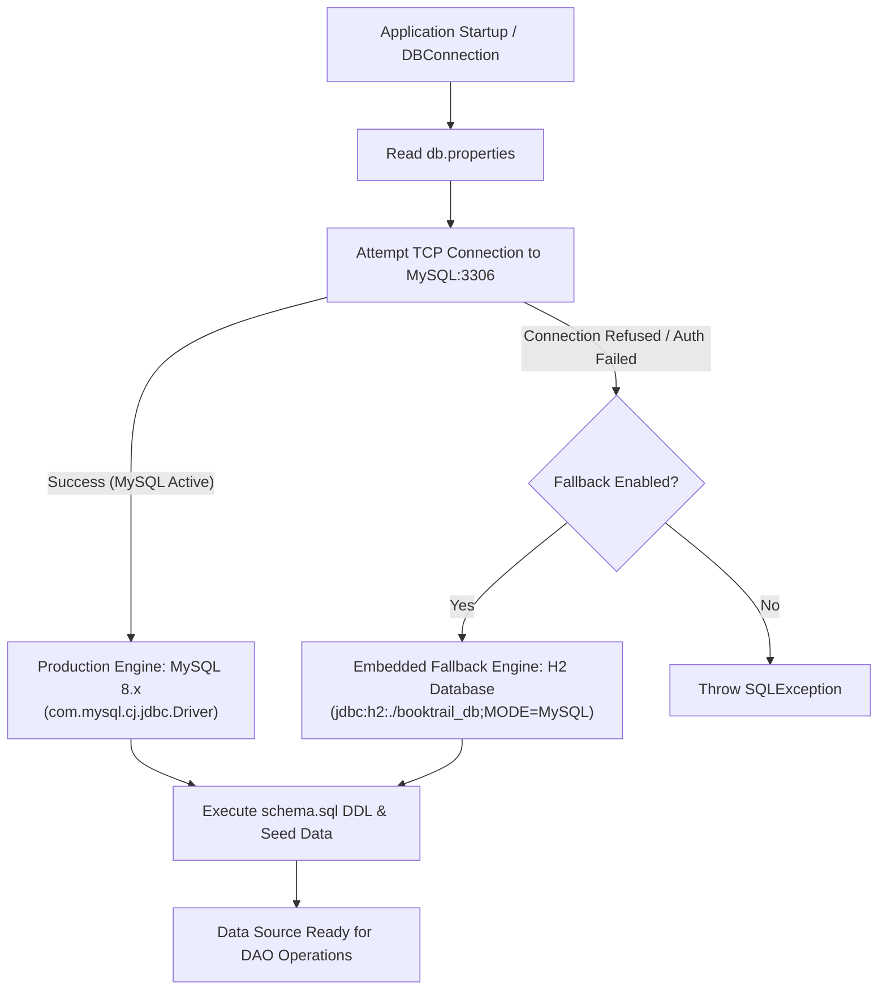
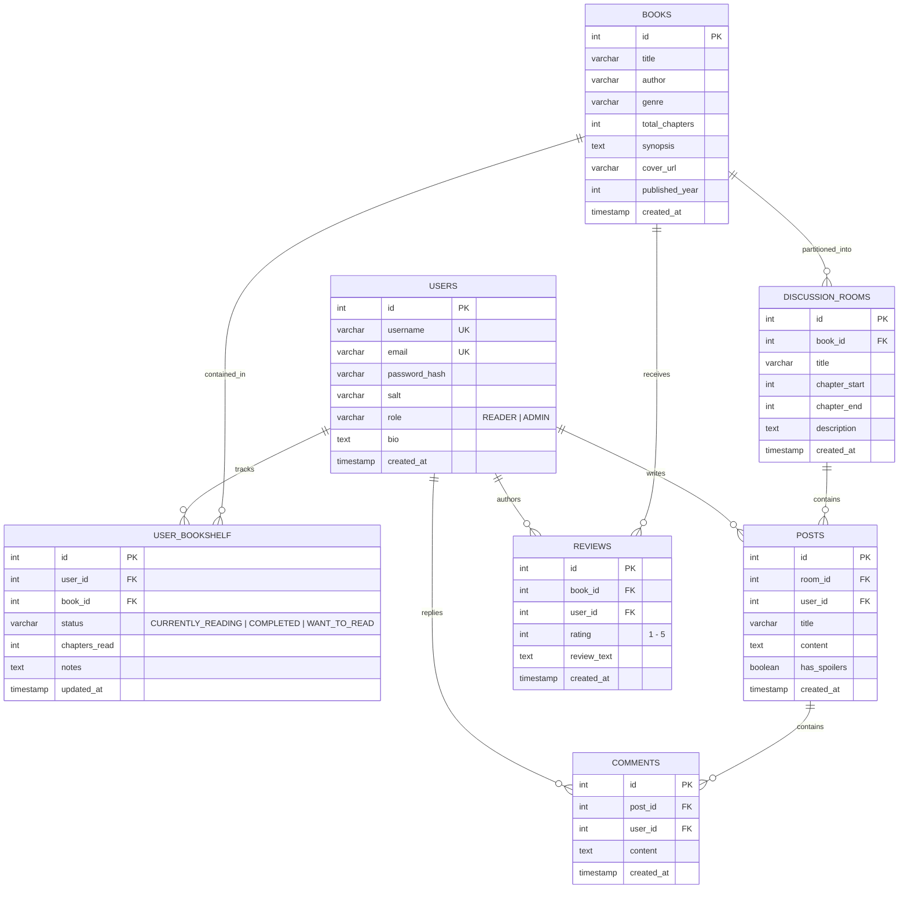
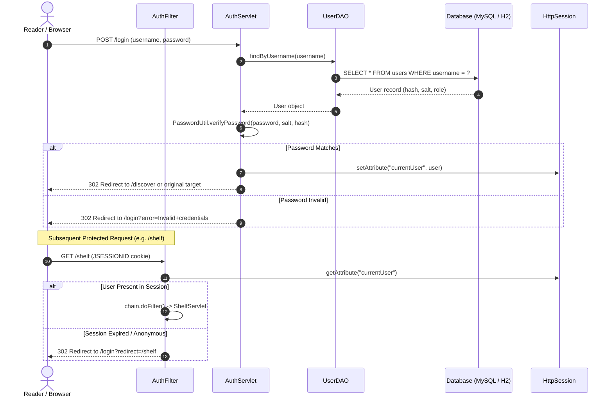
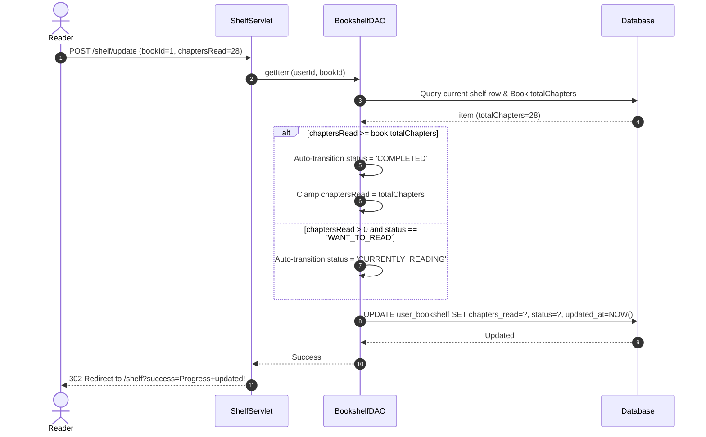
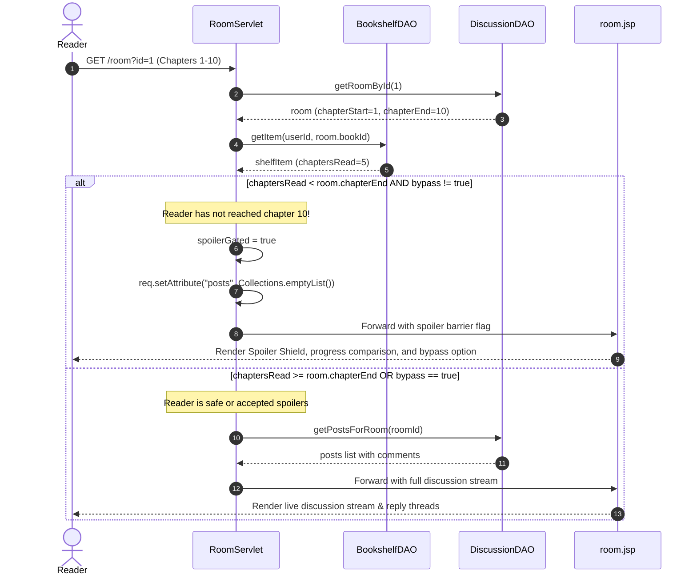

# BookTrail — Technical Architecture & System Flow Specification

---

## 1. Executive Summary & Design Identity

**BookTrail** is a full-stack book discovery and chapter-milestone reading community platform. Its design philosophy embodies a **"Misty Mountain Literary Café"**—combining editorial magazine layouts, warm wooden café tones, and modern reading community features.

The central problem BookTrail solves is **accidental plot spoilers in reading communities**. Unlike conventional social platforms where public feeds spoil major twists, BookTrail partitions book discussions into **chapter-gated rooms** and enforces **server-side spoiler barriers** based on each reader's authenticated reading log.

---

## 2. Database Architecture & Dual-Engine Strategy

BookTrail implements a **resilient dual-database architecture** designed for production performance with zero-configuration local execution.



### 2.1 The Two Databases Used

1. **Primary Database: MySQL 8.x**
   - **Driver**: `com.mysql.cj.jdbc.Driver`
   - **Configuration File**: `src/main/resources/db.properties`
   - **Connection URL**: `jdbc:mysql://localhost:3306/booktrail_db?useSSL=false&allowPublicKeyRetrieval=true&serverTimezone=UTC`
   - **Target**: Production and standard local MySQL environments.

2. **Embedded Fallback Database: H2 Database (v2.2.224)**
   - **Driver**: `org.h2.Driver`
   - **Storage File**: Persistent on disk at `./booktrail_db.mv.db` (in project root)
   - **Connection URL**: `jdbc:h2:./booktrail_db;MODE=MySQL;DATABASE_TO_LOWER=TRUE;DEFAULT_NULL_ORDERING=HIGH`
   - **Why it is used**: If a developer or evaluator does not have MySQL installed or running, [DBConnection.java](file:///c:/Users/ADMIN/OneDrive/Documents/Desktop/booktraill/src/main/java/com/booktrail/config/DBConnection.java) catches the connection error and instantly boots the embedded H2 engine in MySQL-compatibility mode. Data is stored persistently across restarts without any manual installation.

### 2.2 Relational Entity-Relationship Diagram (ERD)



---

## 3. High-Level Technology Stack

| Layer | Technology | Version | Purpose |
| :--- | :--- | :--- | :--- |
| **Runtime** | Java Development Kit (JDK) | 17+ (JDK 26 tested) | Core Java application runtime |
| **Web Server** | Embedded Apache Tomcat | 10.1.20 | Single-process embedded container hosting servlets & JSPs |
| **Servlet API** | Jakarta Servlet | 6.0.0 | Request routing, lifecycle filtering, session state |
| **View Engine** | Jakarta JSP & JSTL | 3.1 / 3.0 | Server-side templating, component layout, and XSS output escaping |
| **Persistence** | Pure JDBC | Standard Java SQL | Direct parameterized PreparedStatements (zero ORM overhead) |
| **Primary DB** | MySQL Server | 8.0+ | Production relational database |
| **Fallback DB**| H2 Database Engine | 2.2.224 | Zero-config embedded disk-persistent relational engine |
| **Security** | Salted SHA-256 | Java `MessageDigest` | Cryptographic password hashing with 16-byte random salt |
| **Frontend** | Vanilla CSS3 & Modern JS | Standard ES6+ | Mountain Café design system, themes, and interactive progress sliders |

---

## 4. Multi-Tier Application Architecture

BookTrail follows the classic **Model-View-Controller (MVC)** layered pattern, strictly separating routing, business rules, and presentation:

```
┌─────────────────────────────────────────────────────────────────────────────┐
│                          CLIENT (Web Browser)                               │
│       HTML5 Views + Mountain Café Design System (style.css + main.js)       │
└──────────────────────────────────────┬──────────────────────────────────────┘
                                       │ HTTP Requests / Form Submissions
                                       ▼
┌─────────────────────────────────────────────────────────────────────────────┐
│                     EMBEDDED TOMCAT WEB CONTAINER                           │
│  ┌───────────────────────────────────────────────────────────────────────┐  │
│  │                    SECURITY FILTER (AuthFilter)                       │  │
│  │    • UTF-8 Character Encoding Enforcement                             │  │
│  │    • Session Authentication Check (currentUser != null)               │  │
│  │    • Role-Based Access Control (Admin route protection)               │  │
│  └───────────────────────────────────┬───────────────────────────────────┘  │
│                                      │ Filter Passed                        │
│                                      ▼                                      │
│  ┌───────────────────────────────────────────────────────────────────────┐  │
│  │                       CONTROLLERS (Servlets)                          │  │
│  │  DiscoverServlet  │ BookServlet    │ AuthServlet   │ ShelfServlet     │  │
│  │  CommunityServlet │ RoomServlet    │ ProfileServlet│ AdminServlet     │  │
│  └───────────────────┬───────────────────────────────────┬───────────────┘  │
│                      │ Calls DAO                         │ Forwards Model   │
│                      ▼                                   ▼                  │
│  ┌────────────────────────────────────────┐ ┌────────────────────────────┐  │
│  │         DATA ACCESS OBJECTS (DAO)      │ │        VIEW LAYER          │  │
│  │  UserDAO      │ BookDAO     │ ShelfDAO │ │  Jakarta JSP 3.1 Templates │  │
│  │  DiscussionDAO│ ReviewDAO              │ │  JSTL 3.0 & XSS <c:out>    │  │
│  └───────────────────┬────────────────────┘ └────────────────────────────┘  │
└──────────────────────┼──────────────────────────────────────────────────────┘
                       │ Parameterized PreparedStatements
                       ▼
┌─────────────────────────────────────────────────────────────────────────────┐
│                       PERSISTENCE LAYER (JDBC)                              │
│       DBConnection (Failover Manager) ──► [ MySQL 8.x  OR  Embedded H2 ]     │
└─────────────────────────────────────────────────────────────────────────────┘
```

---

## 5. End-to-End System & User Flows

### Flow 1: Authentication & Session Protection



---

### Flow 2: Bookshelf Progress Sync & Automatic Completion

When a reader logs chapters read, BookTrail automatically transitions the book status and re-computes personal metrics.



---

### Flow 3: Server-Side Spoiler Protection Barrier

To ensure true spoiler protection, post content is **never sent over the wire** to readers who haven't reached that chapter milestone, unless they choose to explicitly bypass it.



---

### Flow 4: Insecure Direct Object Reference (IDOR) Protection

BookTrail guarantees that users can only delete or mutate their own content, while granting administrators global moderation rights.

```mermaid
sequenceDiagram
    autonumber
    actor Reader as User / Potential Attacker
    participant Servlet as RoomServlet / ProfileServlet
    participant DAO as DiscussionDAO / ReviewDAO
    participant DB as Database

    Reader->>Servlet: POST /post/delete (postId=42)
    Servlet->>DAO: getPostById(42)
    DAO->>DB: SELECT * FROM posts WHERE id = 42
    DB-->>DAO: Post (userId=99)

    Servlet->>Servlet: Check: currentUser.isAdmin() || post.userId == currentUser.id
    alt User is Owner OR User is Admin
        Servlet->>DAO: deletePost(42)
        DAO->>DB: DELETE FROM comments WHERE post_id=42; DELETE FROM posts WHERE id=42;
        Servlet-->>Reader: 302 Redirect with success notification
    else Unauthorized (IDOR Attempt)
        Note over Servlet: Request rejected silently / denied
        Servlet-->>Reader: 302 Redirect without modifying database
    end
```

---

## 6. Project Directory & File Inventory

```
booktraill/
├── pom.xml                                  # Maven POM (JDK 17+, Tomcat Embed 10.1.20, H2, MySQL, JSTL)
├── ARCHITECTURE.md                          # This comprehensive technical specification
├── src/
│   ├── main/
│   │   ├── java/com/booktrail/
│   │   │   ├── config/
│   │   │   │   └── DBConnection.java        # Dual-database manager with auto-failover & schema seeder
│   │   │   ├── dao/
│   │   │   │   ├── UserDAO.java             # User credentials, roles, bios, registration
│   │   │   │   ├── BookDAO.java             # Catalog queries, search, genre filter, book creation
│   │   │   │   ├── BookshelfDAO.java        # Reading logs, chapter progress, completion status, metrics
│   │   │   │   ├── DiscussionDAO.java       # Discussion rooms, posts, threaded comments, IDOR fetchers
│   │   │   │   └── ReviewDAO.java           # Star ratings, written reviews, upsert, IDOR delete
│   │   │   ├── filter/
│   │   │   │   └── AuthFilter.java          # UTF-8 encoding filter, protected routes & admin gatekeeper
│   │   │   ├── model/
│   │   │   │   ├── User.java                # Reader entity (id, username, password_hash, salt, role)
│   │   │   │   ├── Book.java                # Book entity (id, title, author, genre, total_chapters)
│   │   │   │   ├── BookshelfItem.java       # Shelf item entity (user_id, book_id, chapters_read, status)
│   │   │   │   ├── DiscussionRoom.java      # Room entity (chapter_start, chapter_end, post_count)
│   │   │   │   ├── Post.java                # Discussion post entity with attached comments
│   │   │   │   ├── Comment.java             # Threaded reply entity
│   │   │   │   └── Review.java              # Reader review & star rating entity
│   │   │   ├── server/
│   │   │   │   └── TomcatServer.java        # Embedded Apache Tomcat bootstrap, Jasper config, route mappings
│   │   │   ├── servlet/
│   │   │   │   ├── DiscoverServlet.java     # /discover & /books (Home, search, featured showcase)
│   │   │   │   ├── BookServlet.java         # /book (Book details, chapter rooms, reader reviews)
│   │   │   │   ├── AuthServlet.java         # /login, /register, /logout
│   │   │   │   ├── ShelfServlet.java        # /shelf, /shelf/update, /shelf/add, /shelf/remove
│   │   │   │   ├── CommunityServlet.java    # /community (Communal table, book filter pills)
│   │   │   │   ├── RoomServlet.java         # /room, /post/create, /post/delete, /comment/create, /comment/delete
│   │   │   │   ├── ProfileServlet.java      # /profile, /profile/bio, /review/save, /review/delete
│   │   │   │   └── AdminServlet.java        # /admin, /admin/book/add, /admin/book/delete, /admin/room/add
│   │   │   └── util/
│   │   │       └── PasswordUtil.java        # Salt generation & salted SHA-256 verification
│   │   ├── resources/
│   │   │   ├── db.properties                # MySQL connection configuration
│   │   │   └── schema.sql                   # DDL table creation and initial café seed data
│   │   └── webapp/
│   │       ├── WEB-INF/
│   │       │   ├── web.xml                  # Servlet container deployment descriptor
│   │       │   └── views/
│   │       │       ├── discover.jsp         # Café home, mood pills, search, featured cards
│   │       │       ├── book.jsp             # Book detail, chapter rooms list, review form
│   │       │       ├── shelf.jsp            # Personal bookshelf, live chapter sync slider
│   │       │       ├── community.jsp        # Communal table, spoiler-safe room listings
│   │       │       ├── room.jsp             # Server-gated chapter room & conversation stream
│   │       │       ├── login.jsp            # Secure authentication form
│   │       │       ├── register.jsp         # Reader membership registration form
│   │       │       ├── profile.jsp          # Reader journal, reading statistics, review manager
│   │       │       ├── admin.jsp            # Café administrator dashboard & catalog manager
│   │       │       └── includes/
│   │       │           ├── header.jsp       # Navigation bar, theme toggle, mobile drawer
│   │       │           └── footer.jsp       # Editorial footer & copyright notes
│   │       └── static/
│   │           ├── css/
│   │           │   └── style.css            # Mountain Café design system & theme variables
│   │           ├── js/
│   │           │   └── main.js              # Theme manager, drawer toggle, chapter slider sync
│   │           └── images/
│   │               ├── hero-cafe.jpg        # Generated mountain café hero asset
│   │               └── communal-table.jpg   # Generated communal reading table asset
│   └── test/
│       └── java/com/booktrail/
│           └── IntegrationTest.java         # Automated JUnit 5 integration suite (5 test phases)
```

---

## 7. Running & Testing Instructions

### 7.1 Start the Server

To launch the embedded server using the project Maven wrapper:

```powershell
$env:JAVA_HOME="C:\Program Files\Java\jdk-26.0.2"
$env:PATH="$env:JAVA_HOME\bin;$env:PATH"
.\mvnw.cmd exec:java
```

Once initialized, navigate to:
- **`http://localhost:8080/discover`** or **`http://localhost:8080/booktrail/discover`**

### 7.2 Run Automated Verification Tests

To execute the full JUnit 5 integration test suite:

```powershell
.\mvnw.cmd test
```

### 7.3 Seeded Demo Credentials

| Role | Username | Password | Privileges |
| :--- | :--- | :--- | :--- |
| **Reader** | `elena_reader` | `password123` | Shelf tracking, discussions, reviews, bio editing |
| **Admin** | `admin` | `password123` | Full reader privileges + Book/Room catalog management |
